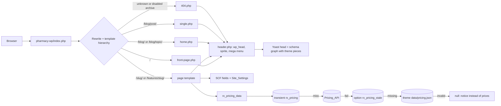

# Design Document: WordPress migration

## Overview

A straight conversion of the PHP site into a classic WordPress theme for the local install at `d:\xampp\htdocs\pharmacy-wp\` (`http://192.168.0.25/pharmacy-wp/`, also reachable as `http://localhost/pharmacy-wp/`). Templates print the same markup as today (same classes, ids and data attributes), so the existing CSS and JavaScript are copied across unchanged. Only the source of the content changes: SCF fields, WordPress menus, the Site Title and Yoast meta.

How each piece is handled:

- **Theme:** parent `pharmacy` holds everything; child `pharmacy-child` is active and starts empty. Classic PHP templates, no `theme.json`, no block styles, no build step.
- **Markup:** each PHP partial becomes a template part and each page file becomes a page template.
- **Content:** SCF field groups saved as JSON in the theme. An import script fills them from data files written from the PHP pages.
- **Live values:** a port of `partials/pricing-data.php` with the same cache order, and shortcodes for live values inside editable text.
- **SEO:** Yoast owns titles, meta, social tags, the sitemap and its schema graph. The theme adds FAQPage, Blog and SoftwareApplication to that graph.
- **Proof:** a Node + playwright-core script compares every PHP page with its WordPress page and writes a per-page report.

The PHP site is not touched: all new repository files live under `wordpress/`. Nothing goes online. The only outbound request is the existing read-only Pricing_API call.

### Key decisions

| Topic | Choice | Reason |
|---|---|---|
| Theme type | Classic theme with PHP templates | Maps 1:1 onto today's partials; no block CSS or global styles |
| Assets | Copied once into `pharmacy/assets/`; the theme owns them from then on | Same files; relative font URLs in `fonts.css` keep working |
| Images | Theme files, not the Media Library. Screens are picked with a select field | SVG screens stay sharp, WordPress blocks SVG uploads, and markup stays identical |
| Editable HTML | SCF textarea fields with no automatic paragraphs, output through shortcodes and then `wp_kses_post()` | A WYSIWYG field runs `wpautop`/`wptexturize`, which would change the copy |
| Tool UI strings | The estimator, demo slip, demo form fields and product-tour mock stay in their template parts as translatable strings. Section headings around them are SCF fields | They are tied to JS ids and to the tour script's sample data |
| Page lookup | Every imported page carries meta `_rx_key` (page key) and `_rx_source` (PHP file) | Links survive slug edits, and the import can find what it already created |
| Blog topics | SCF select on posts, plus one rewrite rule | Gives `/blog/{topic}/` without categories |
| Theme schema | One `wpseo_schema_graph` filter | Keeps a single JSON-LD graph with no duplicate types |

## Architecture

### Folder layout

```
pharmacy/                              repo root = PHP site (unchanged)
└── wordpress/                         every new file lives here
    ├── .gitignore                     tools/node_modules/, tools/out/, *.sql, *.zip, *.log, wp-config*.php, .env, uploads/
    ├── .htaccess                      "Require all denied": blocks /pharmacy/wordpress/* in the PHP site's web root
    ├── themes/
    │   ├── pharmacy/                  parent theme  (junction: pharmacy-wp/wp-content/themes/pharmacy)
    │   │   ├── style.css  functions.php  index.php
    │   │   ├── header.php  footer.php  front-page.php  page.php  home.php  single.php  404.php
    │   │   ├── templates/             feature, legal, pricing, features-hub, switch, faq, about, contact, support, demo
    │   │   ├── parts/                 page-hero, cta-band, faq-list, demo-form, hero-lead, estimator, product-tour,
    │   │   │                          trusted-strip, problems-chat, sprite, blog-card, blog-cover, blog-layouts
    │   │   ├── inc/
    │   │   │   ├── core/              pure PHP with no WordPress calls (also loaded by the tests)
    │   │   │   │   ├── format.php     rx_inr, rx_join, rx_barcode_svg, rx_legal_mark
    │   │   │   │   ├── http.php       rx_is_local_host, rx_host_allowed
    │   │   │   │   ├── pricing.php    rx_pricing_valid, rx_pricing_resolve, plan and prose helpers, rx_term_total
    │   │   │   │   ├── blog.php       rx_safe_post_slug, rx_blog_toc
    │   │   │   │   └── schema.php     rx_faq_schema
    │   │   │   ├── http.php           outbound HTTP allow-list (pre_http_request)
    │   │   │   ├── setup.php          theme supports, menu locations, textdomain, SCF JSON paths, options page, lang + body class
    │   │   │   ├── helpers.php        rx_brand, rx_setting, rx_field, rx_url, rx_page_key, rx_asset, rx_img, rx_svg_img,
    │   │   │   │                      rx_logo, rx_text, rx_html, rx_feature_nav
    │   │   │   ├── enqueue.php        asset map, font preload, favicon
    │   │   │   ├── cleanup.php        front-end extras off, jQuery off, CF7 assets off
    │   │   │   ├── nav.php            Rx_Mega_Walker, Rx_Footer_Walker, #rx: link resolver
    │   │   │   ├── shortcodes.php
    │   │   │   ├── pricing.php        rx_pricing_data() (transient, stale option, snapshot) and template helpers
    │   │   │   ├── blog.php           RX_TOPICS, rewrite rule, slug guard, archive 404s, post queries
    │   │   │   └── seo.php            Yoast filters and schema pieces
    │   │   ├── acf-json/              group_rx_*.json
    │   │   ├── data/pricing.json      copy of partials/data/pricing.json (snapshot)
    │   │   └── assets/                css/ js/ fonts/campton/ img/ (copied from /assets)
    │   └── pharmacy-child/            child theme, active  (junction: pharmacy-wp/wp-content/themes/pharmacy-child)
    │       ├── style.css              header only (Template: pharmacy)
    │       └── functions.php          empty hook point for site-specific overrides
    ├── import/
    │   ├── setup.php                  activate plugins and the child theme, permalinks, Yoast options
    │   ├── import.php                 settings, pages, posts, fields, menus, Yoast meta, sample-content cleanup
    │   ├── lib/                       guard.php (local-only checks), upsert.php, fields.php
    │   └── content/                   settings.php, menus.php, pages/*.php, posts/*.php (PHP data arrays)
    └── tools/
        ├── package.json               playwright-core, fast-check, pixelmatch, pngjs (exact versions)
        ├── baseline.ps1               PHP site file hashes: -Record / -Verify
        ├── parity/check.mjs           Requirement 13 checks and report
        ├── parity/pages.json          PHP URL ↔ WordPress URL pairs
        └── test/                      node --test files + php/bridge.php, php/oracle.php
```

Local-only items that stay out of Git: the two directory junctions (`mklink /J`), the plugin folders `secure-custom-fields`, `wordpress-seo` and `contact-form-7` copied from `d:\xampp\htdocs\labora-wp\wp-content\plugins\`, uploads, and the database.

Every theme PHP file starts with `defined( 'ABSPATH' ) || exit;`. Files in `inc/core/` also accept `RX_TESTING`, so the tests can load them. As a result, a direct request prints nothing even without the `.htaccess`. Import and tool scripts exit unless `PHP_SAPI === 'cli'`. The `.htaccess` only applies to URLs under `/pharmacy/wordpress/`. WordPress reaches the theme through the junction path `/pharmacy-wp/wp-content/themes/...`, which Apache walks separately.

### Request flow



### Page map

| PHP file | WordPress item (slug → URL) | Template | Page key | CSS / JS beyond the base files |
|---|---|---|---|---|
| `index.php` | Page "Home" (`home`), front page → `/` | `front-page.php` | home | home, estimator, tour / tour.js |
| `pricing.php` | Page "Pricing" → `/pricing/` | `templates/pricing.php` | pricing | pages / pricing.js |
| `features/index.php` | Page "Features" → `/features/` | `templates/features-hub.php` | features | feature |
| `features/{billing, expiry, inventory, purchase, reports, gst, retention, security}.php` | 8 child pages of Features → `/features/billing/` … | `templates/feature.php` | billing … security | feature (+ estimator when `leaks_estimator` is on, i.e. expiry) |
| `switch.php`, `faq.php` | Pages "Switch", "FAQ" → `/switch/`, `/faq/` | `templates/switch.php`, `templates/faq.php` | switch, faq | pages |
| `about.php`, `contact.php`, `support.php`, `demo.php` | Pages → `/about/`, `/contact/`, `/support/`, `/demo/` | own template each | about, contact, support, demo | – |
| `privacy.php`, `terms.php`, `refund-policy.php`, `cookie-policy.php`, `data-security.php` | Pages → `/privacy/`, `/terms/`, `/refund-policy/`, `/cookie-policy/`, `/data-security/` | `templates/legal.php` | privacy, terms, refund, cookies, data-security | – |
| `blog/index.php` | Page "Blog", posts page → `/blog/`; topic views → `/blog/{topic}/` | `home.php` | blog | blog |
| `blog/*.php` (6 posts) | Posts → `/blog/{slug}/` | `single.php` | blog | blog / blog.js |
| none (new) | 404 | `404.php` | generic | – |

Every page loads `site.css`, `fonts.css`, `layout.css` and `site.js`. A page's title (`post_title`) is today's breadcrumb label, for example "Billing & counter" or "Privacy". `page.php` (hero plus `the_content()`) handles any page added later.

## Components and Interfaces

### 1. Bootstrap and helpers

`functions.php` requires `inc/core/*.php` and then the WordPress-aware files. `inc/setup.php`:
- On `after_setup_theme`: `add_theme_support( 'title-tag' )`, `add_theme_support( 'html5', [ 'script', 'style' ] )`, `register_nav_menus()` (section 3) and `load_theme_textdomain( 'pharmacy' )`.
- On `acf/init`: `acf_add_options_page()` for "Site settings" (`rx-settings`).
- Filters `acf/settings/save_json` and `acf/settings/load_json` point at `get_template_directory() . '/acf-json'`.

Helpers ported from `partials/config.php`. Output stays the same; names get the `rx_` prefix:

| PHP site | Theme | Notes |
|---|---|---|
| `BRAND` | `rx_brand()` | `get_bloginfo( 'name' )` |
| `SITE[…]`, `HERO_PATTERN`, `PRICING_*` | `rx_setting( $key )` | SCF option value; `''` when empty |
| – | `rx_field( $name, $post_id = null )` | `get_field()` wrapper; `null` when SCF is inactive |
| `url( $key )` | `rx_url( $key )` | Page with `_rx_key = $key` → `get_permalink()`. Fallback keys: `retail`, `chain`, `hospital` → `/#solutions`; `new-pharmacy` → `/#switching`; `calculator` → `/#estimator`; `checklist` → `/#checklist`. `guides` → Blog. Unknown → home. The key map is built from one query per request |
| `$page_key` | `rx_page_key()` | Front page `home`; page → `_rx_key`; posts page, topic view and single post → `blog`; anything else → `generic` |
| `asset()` | `rx_asset( $path )` | `get_theme_file_uri( 'assets/' . $path )`, so the child theme can override a single file |
| `img_tag()`, `svg_img()`, `barcode_svg()`, `logo()`, `inr()` | `rx_img()`, `rx_svg_img()`, `rx_barcode_svg()`, `rx_logo()`, `rx_inr()` | Same arguments and markup |
| `e()` | `esc_html()`, `esc_attr()`, `esc_url()` | |
| `NAV_FEATURES` lookups | `rx_feature_nav()` | `[ key => [ label, description, icon, url ] ]` read from the `primary` menu's Features items. The features hub, related rows and blog CTAs use it, so menu and pages can't drift apart |
| – | `rx_text( $v )` / `rx_html( $v )` | `do_shortcode()`, then `esc_html()` or `wp_kses_post()`. Every SCF value is printed through one of these two, so this is the single place shortcodes run |

### 2. Assets

`inc/enqueue.php` (on `wp_enqueue_scripts`) loads the base files everywhere and the extras by page key:

| Handle | File | Loaded on |
|---|---|---|
| `rx-site`, `rx-fonts`, `rx-layout` | `css/site.css`, `css/fonts.css`, `css/layout.css` | every page |
| `rx-home`, `rx-tour` | `css/home.css`, `css/tour.css` | home |
| `rx-estimator` | `css/estimator.css` | home, feature pages with `leaks_estimator` on |
| `rx-pages` | `css/pages.css` | pricing, faq, switch |
| `rx-feature` | `css/feature.css` | features hub, feature pages |
| `rx-blog` | `css/blog.css` | blog hub, topic views, posts |
| `rx-site-js` | `js/site.js` | every page |
| `rx-tour-js`, `rx-pricing-js`, `rx-blog-js` | `js/tour.js`, `js/pricing.js`, `js/blog.js` | home, pricing, posts |

- Scripts use `[ 'in_footer' => true, 'strategy' => 'defer' ]` with no dependencies. Styles keep today's `<link>` order. The version is the theme version.
- The `wp_preload_resources` filter preloads `campton-400.woff2` and `campton-700.woff2` (`as=font`, `type=font/woff2`, `crossorigin`).
- A `wp_head` callback prints the SVG favicon (`img/logo-mark.svg`).

### 3. Header, mega menu and footer

Menu locations: `primary`, `footer_features`, `footer_solutions`, `footer_resources`, `footer_company`, `legal`. The import builds `primary` like this:

```
Features                (custom link "#")          → <li class="hd-has"><button class="hd-link"> + #mm-features .mm.mm-wide
  Run the counter       (custom link "#")          → .mm-col + p.mm-h
    Billing & counter   (page)                     → a.mm-item (icon + description from SCF)
    Expiry & batch, Stock & reorder, Purchase & suppliers
  Run the business      (custom link "#")
    Reports & dashboard, GST & accounts, Customer retention, Security & roles
Solutions               (custom link "#")          → #mm-solutions .mm > .mm-col
  Retail medical store (#rx:retail), Pharmacy chain (#rx:chain), Hospital pharmacy (#rx:hospital), Opening a new pharmacy (#rx:new-pharmacy)
Pricing (page), Switch (page)                      → <li><a class="hd-link">
Resources               (custom link "#")          → #mm-resources .mm > .mm-col
  Expiry loss calculator (#rx:calculator), Buyer’s checklist (#rx:checklist), Blog & guides (page), FAQ (page), Help & support (page)
```

- **Rx_Mega_Walker** (`extends Walker_Nav_Menu`) rewrites `start_lvl`, `end_lvl`, `start_el` and `end_el` to print the exact markup of `partials/header.php`:
  - The panel id comes from the top item's title (`mm-features`, `mm-solutions`, `mm-resources`).
  - `display_element()` checks whether a top item has grandchildren. If so, the panel gets `.mm-cols` with one `.mm-col` per group, followed by the `.mm-promo` aside, which is built from Site_Settings (`promo_image`, `promo_alt`, `promo_title`, `promo_text`, `promo_link_label`) and links to the Features page.
  - No WordPress menu classes or ids are printed.
- **Call:** `wp_nav_menu( [ 'theme_location' => 'primary', 'container' => false, 'items_wrap' => '<ul class="hd-menu">%3$s</ul>', 'depth' => 3, 'fallback_cb' => false, 'walker' => new Rx_Mega_Walker() ] )`.
- **Active state:** a top item gets `is-active` when `rx_page_key()` equals the `_rx_key` of the item or of any descendant. This reproduces today's key lists.
- **`#rx:{key}` links:** custom links whose URL is `#rx:{key}` are resolved at render time by a `nav_menu_link_attributes` filter. URL settings (`app_login`, `app_signup`, `help_url`) resolve to the Site_Settings value; any other key goes through `rx_url()`. Unbuilt pages therefore keep pointing at home anchors, and the link switches automatically once a page with that `_rx_key` exists, just like today's `PAGES` registry.
- **Header actions:** the mobile actions and `.hd-actions` (Log in, Start free, Book a free demo, burger) are template markup in `header.php`. Their URLs come from Site_Settings and `rx_url( 'demo' )`.
- **Footer:**
  - `footer.php` prints `parts/cta-band` unless the template calls `get_footer( null, [ 'hide_cta' => true ] )` (home and demo do).
  - The four link columns use `wp_nav_menu()` with **Rx_Footer_Walker** (`<li><a>` inside `<ul class="links">`). Each column heading is the menu's name ("Features", "Solutions", "Resources", "Company").
  - The `legal` menu prints bare `<a>` links inside `<nav aria-label="Legal">`.
  - Brand blurb, contacts, social icons, the copyright note and `.ft-word` come from Site_Settings and `rx_brand()`.
  - The mobile bar uses `sales_tel`, `app_signup` and `rx_url( 'demo' )`.

### 4. Templates and parts

Each template calls `get_header()`, prints `<main id="main">`, its sections and parts, then `</main>` and `get_footer()`. Parts are loaded with `get_template_part( 'parts/x', null, $args )`. The `$args` replace today's include-time variables (`$hero`, `$lead_id`, `$est_cta`, `$form_title`, `$form_sub`, FAQ items, id prefixes).

| Template | Sections in order (parts in bold) |
|---|---|
| `front-page.php` | hero + **hero-lead** (`id` `hl1`), **trusted-strip**, **product-tour**, **problems-chat**, **estimator** (`cta` `#demo`), day, feature tabs (`data-scroll-tabs`), switching, who it's for, buyer's checklist, support, FAQ (**faq-list**), demo + **demo-form**; `hide_cta` |
| `templates/feature.php` | **page-hero**, CTAs + assure + screen, scenes, leak register (+ **estimator** with `cta` = demo URL), steps + shortcut keys, capabilities, guide, proof, related, FAQ (**faq-list**). A direct port of `partials/feature-page.php`; each section is skipped when its fields are empty, as today |
| `templates/legal.php` | **page-hero** (with meta line), TOC + prose with notice. Section HTML is `rx_html()` and then `rx_legal_mark()`, so shortcodes resolve before `[placeholders]` are wrapped |
| `templates/pricing.php` | **page-hero**, term bar + plan cards, comparison table (`data-collapse`), credits table, pricing FAQ (**faq-list**) |
| `templates/features-hub.php` | **page-hero**, CTAs + assure, problem index, two module groups, hospital/chain block, plans table, FAQ |
| `templates/{switch, faq, about, contact, support, demo}.php` | Same sections as the PHP file. Contact and demo use **demo-form**; demo uses `hide_cta` |
| `home.php` | Blog hub (section 7) |
| `single.php` | Post layout (section 7) |
| `404.php` | page-hero-style heading, short message, links to home, features, pricing and the blog |
| `page.php`, `index.php` | **page-hero** + `the_content()` |

Part arguments that keep markup identical across pages:
- `faq-list`:
  - `items` (question, answer, confirmed).
  - `ids`: answer and button id formats plus a start index (`faq-%d` / `faq-b%d` / 1 on home; `{key}q%d` / `{key}q%db` / 0 on feature pages; `pq%d` / `pq%db` on pricing).
  - `confirm_on` (`item`, or `answer` on pricing).
  - Items whose question or answer renders empty are skipped. This is how plan-dependent FAQs disappear.
- `demo-form`: `title`, `sub` and `success_title`. The home form's own strings come from Home fields.
- `trusted-strip`: lists the logo files in `assets/img/trusted/`, using the child theme's folder when it has files and the parent's otherwise. Alt text is built from the filename, as today.

### 5. SCF fields and Site_Settings

Field groups live in `acf-json/group_rx_{group}.json`. Keys are predictable so the import can write by key: `field_rx_{group}_{name}`, with sub-fields named `field_rx_{group}_{parent}_{name}`. Conventions:

- `hero` is a group (`crumb`, `parent`, `eyebrow`, `h1`, `lead`, `meta`, `pattern` = inherit/on/off) on every inner-page group.
- `*_head` is a group (`eyebrow`, `title`, `intro`) used for a section heading.
- Fields ending in `_html` are textareas (no formatting) printed with `rx_html()`. All other text uses `rx_text()`.
- `confirmed` (true/false, default on) appears on every FAQ item and on every list item that carries `data-confirm` today. When it is off, the element gets `data-confirm`, and an FAQ item also stays out of FAQPage schema.
- `screen` is a select of the 10 files in `assets/img/screens/`. `icon` is a select of the sprite symbol ids. `feat` holds a pricing API `unique_name`; `plan` holds the fixed plan text used when `feat` is empty.

Field groups and where they appear: listed under Data Models.

### 6. Shortcodes

| Shortcode | Output | Replaces |
|---|---|---|
| `[rx_brand]` | Site Title | `BRAND` |
| `[rx_site key="support_phone"]` | A Site_Settings text value | `SITE[...]` |
| `[rx_tel key="sales\|support" class=""]` | `<a href="tel:…">+91 …</a>` | tel links in copy |
| `[rx_url key="pricing"]` | URL of a page key, for plain-text use | `url()` |
| `[rx_link key="pricing" setting="" hash="" class=""]text[/rx_link]` | `<a href>` to a page key or a Site_Settings URL | `<a href="' . url(...) . '">` inside copy (no shortcodes inside attributes) |
| `[rx_plan feat="feat_x" fallback="" before="" after=""]` | Live plan label, else `fallback`. `before`/`after` print only when a label exists | `feature_plan_label()` |
| `[rx_free_plan field="name\|sales\|purchase\|users\|users_text" before="" after=""]` | A fact about the free plan; empty when unknown | `pricing_split()['free'][0]`, `plan_bill_limits()` |
| `[rx_cost_text]`, `[rx_compare_text]`, `[rx_terms_text]`, `[rx_users_text]`, `[rx_credits_text]` | Same prose as the PHP helpers | `pricing_cost_text()` and siblings |
| `[rx_if cond="pricing\|free\|no_free\|free_sales_limit"]…[/rx_if]` | Inner content only when the condition holds | Conditional sentences and items |

Unregistered bracketed text, such as legal `[placeholders]`, passes through `do_shortcode()` unchanged.

### 7. Blog

- **Topics:** `RX_TOPICS` in `inc/blog.php` holds `expiry` ("Expiry & stock", teal), `purchase` ("Purchase", blue), `switching` ("Switching", navy), `staff` ("Counter & staff", amber) and `buying` ("Buying guides", slate). Posts store a topic key in the SCF `topic` select.
- **Front page and posts page:** permalinks are `/blog/%postname%/`, `show_on_front=page`, `page_on_front` = Home and `page_for_posts` = Blog.
- **Topic views:** `add_rewrite_rule( '^blog/(expiry|purchase|switching|staff|buying)/?$', 'index.php?pagename=blog&rx_topic=$matches[1]', 'top' )`, with the pattern built from `RX_TOPICS`. `rx_topic` is registered as a query var. WordPress treats `pagename=blog` as the posts page, so `home.php` renders the topic view.
- **Slug guard:** a `wp_unique_post_slug` filter passes post slugs through `rx_safe_post_slug()`, which appends `-guide` to a slug equal to a topic key. A numeric suffix is added if that slug is already taken.
- **Unknown URLs:** an unknown `/blog/x/` finds no post and returns 404. A `template_redirect` callback also sends the unused archives (category, tag, date, author, search, feed, attachment) to 404.
- **Post list:** `rx_blog_posts()` returns all published posts, newest first, with the card fields. The hub ignores the main query's paging.
- **`home.php`:** page-hero (topic views change crumb, parent link and h1), topic links with counts and `aria-current` pointing at `/blog/{topic}/`, featured guide (newest post with `featured` on) and "Start here" (Blog page field) when no topic is set, the grid ("Latest guides" or "N guides", with the empty message), and the tools strip. Cards and covers come from `parts/blog-card.php` and `parts/blog-cover.php`.
- **`single.php`:**
  - Top: progress bar, page-hero (crumb = topic name, parent "Blog & guides" linked).
  - Meta bar: topic link, "The {brand} team", date as `j M Y`, read time, optional updated date, and the copy-link button. `data-copy` holds the root-relative permalink, because `blog.js` prepends `location.origin`.
  - Body: cover, aside (TOC + demo box), article, byline, FAQ, and "Keep reading" (same topic first, then newest, 3 cards).
  - The article is the `body` flexible content rendered by `parts/blog-layouts.php` into a buffer and passed through `rx_blog_toc( $html )`. That function uses the same regex and slug rule as `blog_end()` today, returning the html with ids plus the TOC entries.

### 8. Pricing service

- **Pure core (`inc/core/pricing.php`):** every function takes the pricing array `$d`:
  - `rx_pricing_valid`, `rx_pricing_plans`, `rx_pricing_plan`, `rx_plan_price`, `rx_plan_bill_limits`, `rx_pricing_terms_text`, `rx_pricing_split`, `rx_pricing_cost_text`, `rx_pricing_compare_text`, `rx_feature_plan`, `rx_feature_plan_label`, `rx_plan_users_text`, `rx_plan_credits_text`, `rx_term_total` and `rx_pricing_meta_bits` (pricing meta description).
  - `rx_pricing_resolve( array $sources, array $hooks ): array` tries the sources in order `cache → live → stale → snapshot`. It validates each with `rx_pricing_valid()`, calls `on_live` or `on_stale`, and returns `[ data|null, source ]`.
- **WordPress wrapper (`inc/pricing.php`):** `rx_pricing_data(): ?array`, memoised per request:
  - cache = `get_transient( 'rx_pricing' )`
  - live = `wp_remote_get( rx_setting( 'pricing_api' ), [ 'timeout' => 5, 'headers' => [ 'Accept' => 'application/json' ] ] )`, HTTP 200 + JSON; skipped when the setting is empty
  - `on_live` = `set_transient( 'rx_pricing', $d, pricing_ttl (300) )` + `update_option( 'rx_pricing_stale', $d, false )`
  - stale = `get_option( 'rx_pricing_stale' )`; `on_stale` = `set_transient( 'rx_pricing', $stale, pricing_retry (60) )`, so the API is retried after a minute, like today's `touch()`
  - snapshot = `get_theme_file_path( 'data/pricing.json' )`
- **Template helpers:** `rx_pricing_cell()` (comparison cell, port of `cell()`) and `rx_pricing_notice()`. The notice reads "Prices are updating. Call sales on {sales_phone} or book a free demo." and is shown where prices would be when `rx_pricing_data()` is null.
- **Pricing page fields:** "Who it's for" lines (`plan_fit`) and friendlier feature labels (`feature_labels`) are Pricing fields instead of PHP arrays.
- **Meta description:** a `wpseo_metadesc` filter on the pricing page rebuilds the description from live plans. It falls back to the stored Yoast description when pricing is null.

### 9. Scripts, interactions and forms

The JS files are unchanged. Templates keep every hook they look for:
- `[data-lead-form]`, `#demo-form`, `#f-want`, `#submit-label`, `[data-cta]`
- `[data-scroll-tabs]`, `[role=tablist]`, `.faq-btn`
- `#purchase`, `#expiry` and their outputs
- `input[name=term]`, `[data-collapse]`, `.pc-toggle`, `.pc-all`
- the tour markup
- `.b-progress`, `.b-toc`, `[data-copy]`, `[data-print]`, `[data-year]`

Forms have no `action` and no endpoint; nothing is sent anywhere. Query strings used by the scripts (`?review`, `?want=quote`, `?tour-at=`) are not WordPress query vars and pass through unchanged. Contact Form 7 stays active: `wpcf7_load_js` and `wpcf7_load_css` return false, and no field contains a CF7 shortcode.

### 10. Design, accessibility and responsive layout

These are covered by identical markup and CSS. Theme-specific points:
- `header.php` prints `parts/sprite`, the skip link and the review banner right after `wp_body_open()`, in today's order.
- A `language_attributes` filter outputs `lang="en-IN"`.
- A `body_class` filter reduces the classes to `page-{key}`, plus `admin-bar`/`logged-in` for logged-in editors only.
- No block CSS loads.
- Visitors never see the admin bar.
- "Healthray" appears only in Site_Settings link targets, never as text. Yoast's organisation name is the Site Title.

### 11. Performance cleanup

Front-end only (`inc/cleanup.php`):
- Deregister `jquery`.
- Remove emoji detection, styles and filters.
- Dequeue `wp-block-library`, `wp-block-library-theme`, `classic-theme-styles` and `global-styles`, and remove `wp_enqueue_global_styles`.
- Remove the image auto-sizes CSS fix (hook name per this WP version).
- Deregister `wp-embed` and remove oEmbed discovery and host JS.
- Return `null` from `wp_speculation_rules_configuration`.
- Remove `wp_generator`, `rsd_link`, `wlwmanifest_link`, `wp_shortlink_wp_head`, `rest_output_link_wp_head`, feed links and adjacent-post links.
- Return false from `wpseo_debug_markers`.

Images keep width, height, `loading` and `decoding` from the `rx_img*` helpers. Templates print them directly, outside `the_content`, so no WordPress image filters touch them.

Outbound HTTP (`inc/http.php`): a `pre_http_request` filter allows only local hosts (`localhost`, `127.0.0.1`, `192.168.*`) and the Pricing_API host (`rx_host_allowed()`). Everything else gets a `WP_Error`, which also stops core, plugin and Yoast update checks on this local install.

### 12. SEO and schema

| Output | Owner | How |
|---|---|---|
| `<title>` | Yoast | `_yoast_wpseo_title` = today's title text + ` %%sep%% %%sitename%%`, with separator `sc-pipe`, giving "Pricing: … \| Rxtiva". The brand stays live. Topic views use a `wpseo_title` filter ("Expiry & stock guides for medical stores") |
| Meta description | Yoast | `_yoast_wpseo_metadesc`. Pricing is live via `wpseo_metadesc`; topic views reuse the hub description |
| Robots | Yoast | `_yoast_wpseo_meta-robots-noindex = 1` on privacy, terms, refund-policy and cookie-policy |
| Canonical, Open Graph, Twitter | Yoast | Defaults. Topic views get canonical `/blog/{topic}/` (`wpseo_canonical`, `wpseo_opengraph_url`); `wpseo_locale` → `en_IN` |
| XML sitemap | Yoast | Pages and posts. Category, tag, author and date archives are excluded. WordPress core sitemaps are off (Yoast disables them) |
| WebSite, Organization, WebPage, BreadcrumbList, Article | Yoast | `company_or_person=company`, `company_name` empty, which falls back to the Site Title, and `company_logo` = logo-mark attachment created by the import (Yoast needs a logo attachment to output Organization) |
| Article author | Theme | `wpseo_schema_graph`: the Article `author` points at the Organization `@id`, and Person nodes are removed |
| FAQPage | Theme | Appended to the graph on the features hub, feature pages, FAQ page and posts. Confirmed items only, via `rx_faq_schema()` |
| Blog + BlogPosting | Theme | Appended on the blog hub and topic views (as today): one BlogPosting per post (headline, datePublished, url) |
| SoftwareApplication + Offer | Theme | Pricing page: name = brand, `applicationCategory` BusinessApplication, `operatingSystem` "Web browser", one Offer per non-custom plan (name, price, `priceCurrency` INR). Omitted when pricing is null |

The theme prints no `<title>`, meta tag or JSON-LD of its own. Yoast's breadcrumb HTML is not used, because the hero prints the visible crumbs. The fallback to the site name and the logo requirement were checked in `src/context/meta-tags-context.php` of the Yoast copy in `labora-wp`.

### 13. Setup and import

`wordpress/import/setup.php` (run once with `D:\xampp\php\php.exe`, bootstraps `pharmacy-wp/wp-load.php`):
1. `rx_assert_local()`: CLI only, `DB_HOST` is local, and `siteurl`/`home` hosts are `localhost`, `127.0.0.1` or `192.168.*`. Otherwise it aborts.
2. Checks that the plugin folders and theme junctions exist, then runs `activate_plugin()` for `secure-custom-fields/secure-custom-fields.php`, `wordpress-seo/wp-seo.php` and `contact-form-7/wp-contact-form-7.php`, and `switch_theme( 'pharmacy-child' )`.
3. Options: `permalink_structure=/blog/%postname%/`, `default_comment_status=closed`, `default_ping_status=closed`.
4. Yoast settings through `WPSEO_Options::set()`: `separator=sc-pipe`, `title-page` and `title-post` = `%%title%% %%sep%% %%sitename%%`, `company_or_person=company`, `company_name=''`, `disable-author`, `disable-date`, `noindex-tax-category`, `noindex-tax-post_tag`, `breadcrumbs-enable=false`, `tracking=false`.
5. `flush_rewrite_rules( false )`. The `.htaccess` already has the WordPress block.

`wordpress/import/import.php` (re-runnable):
1. `rx_assert_local()`.
2. Site_Settings from `content/settings.php` → `update_field( 'field_rx_settings_{name}', $v, 'option' )`.
3. Pages from `content/pages/*.php`, parents first:
   - Find the page by `_rx_source`, then `wp_update_post()` or `wp_insert_post()` with `post_status=publish`, `comment_status=closed`, `page_template`, `post_parent` and `meta_input` (`_rx_key`, `_rx_source`, `_yoast_wpseo_title`, `_yoast_wpseo_metadesc`, `_yoast_wpseo_meta-robots-noindex`).
   - Then fields by key. Rows use sub-field names, and flexible rows carry `acf_fc_layout`.
4. Posts from `content/posts/*.php`: the same steps, plus `post_date`.
5. `show_on_front`, `page_on_front`, `page_for_posts`, and `wp_page_for_privacy_policy` = the Privacy page.
6. Menus from `content/menus.php`: create or reuse each menu by name, delete that menu's existing items, add the items in order, set `icon`/`description` fields, and assign the locations.
7. Logo attachment, created once from the theme's `logo-mark.svg` and found by `_rx_source`. Sets Yoast `company_logo` and `company_logo_id`.
8. Deletes the WordPress sample content once: "Hello world!", "Sample Page" and the draft "Privacy Policy", matched by slug and by having no `_rx_source`. This is the only deletion.
9. `flush_rewrite_rules( false )` and a summary of created, updated and failed items. Exits non-zero on failures.

Data files are written by hand from the PHP files:
- Copy the text exactly, including curly quotes.
- Replace helper calls with the matching shortcode.
- Keep literal text literal where the PHP page is literal.
- Keep illustrative numbers as text.
- Keep `[bracketed placeholders]`, and turn `data-confirm` into `confirmed => false`.

Example:

```php
<?php // wordpress/import/content/pages/pricing.php  (from pricing.php)
return [
  'source'   => 'pricing.php',
  'key'      => 'pricing',
  'title'    => 'Pricing',
  'slug'     => 'pricing',
  'template' => 'templates/pricing.php',
  'seo'      => [ 'title' => 'Pricing: pharmacy software plans from free to Enterprise %%sep%% %%sitename%%',
                  'desc'  => 'Simple yearly plans for medical stores: … Compare every feature.', 'noindex' => false ],
  'fields'   => [
    'hero' => [ 'crumb' => 'Pricing', 'eyebrow' => 'Pricing', 'h1' => 'Simple yearly plans. Prices on the page.', 'lead' => '…' ],
    'faq'  => [
      [ 'q' => 'Can I pay for more than one year?', 'a_html' => 'Yes. Paid plans can be bought for [rx_terms_text].', 'confirmed' => true ],
      [ 'q' => 'What happens when I reach the [rx_free_plan field="name"] limit?',
        'a_html' => '[rx_if cond="free_sales_limit"][rx_free_plan field="name"] includes [rx_free_plan field="sales"] sales bills[rx_free_plan field="purchase" before=" and " after=" purchase bills"] a month for [rx_free_plan field="users_text"]. When you need more, upgrade to a paid plan for unlimited bills.[/rx_if]',
        'confirmed' => true ],
    ],
  ],
];
```

## Data Models

### Site_Settings (options page `rx-settings`, group `group_rx_settings`)

| Tab | Fields |
|---|---|
| Contacts | `sales_phone`, `sales_tel`, `support_phone`, `support_tel`, `email`, `company`, `address`, `map_query` |
| Links | `app_login`, `app_signup`, `help_url`, `calendly` |
| Social | `social` repeater: `network` (LinkedIn, YouTube, Instagram, Facebook, X), `url` |
| Layout | `hero_pattern` (true/false), `footer_blurb`, `footer_note`, `cta_title`, `cta_text`, `promo_image`, `promo_alt`, `promo_title`, `promo_text`, `promo_link_label` |
| Pricing | `pricing_api`, `pricing_ttl` (default 300), `pricing_retry` (default 60) |

The import fills these with today's `partials/config.php` values. An empty value hides the element that uses it, as `email` and `social` do today.

### Page and post field groups

| Group (location) | Fields (repeaters show sub-fields in brackets) |
|---|---|
| Home `group_rx_home` (front page; one tab per section) | **Hero:** `hero_eyebrow`, `hero_title_html`, `hero_lead_html`, `hero_tour_label`, `hero_free_label`. **Trusted:** `trusted_title`, `trusted_note`. **Tour:** `tour_eyebrow`, `tour_title_html`, `tour_intro`. **Problems:** `problems_head`, `problems_note`, `problems` [icon, topic, quote, why, fix, who, time]. **Day:** `day_head`, `day` [time, ampm, title, text]. **Features:** `features_head` (intro as html), `tabs` [slug, icon, label, title, lead, points [html], screen, screen_alt]. **Switching:** `switching_head`, `moved_title`, `moved` [text], `from` [html, confirmed], `switch_steps` [title, text, when], `switch_button`. **Who it's for:** `solutions_head`, `solutions` [icon, who, title, text, featured, checks [text]]. **Checklist:** `checklist_head`, `checklist_cols` [label], `checklist` [ask, why, answer_html, confirmed], `checklist_foot_html`, `checklist_button`, `checklist_button_confirmed`. **Support:** `support_head`, `support_points` [html, confirmed], `channels` [icon, title, html]. **FAQ:** `faq_head`, `faq_call_label`, `faq` [q, a_html, confirmed]. **Demo:** `demo_head`, `demo_html`, `demo_steps` [title, text], `demo_steps_confirmed`, `form_title`, `form_sub`, `form_success` |
| Feature `group_rx_feature` (template feature) | `hero`, `cta_demo`, `cta_free`, `assure` [text], `screen`, `screen_alt`, `scenes_head`, `scenes` [time, title, text, cost], `leaks_head`, `leaks` [leak, how, plug_html, feat, plan], `leaks_example` group [title, lines [label, value, op], result_label, result_value, note] (empty title → demo card), `leaks_estimator`, `steps_head`, `steps` [title, html, meta], `keys` [key, what], `caps_head`, `caps` [icon, title, html, feat, plan], `guide_head`, `guide` [title, html], `guide_note`, `proof_head`, `proof` [text], `related` (multi-select of feature page keys), `related_title`, `faq_title`, `faq` [q, a_html, confirmed] |
| Legal `group_rx_legal` (template legal) | `hero` (with `meta`), `notice_html` (empty → today's default draft notice), `sections` [anchor, heading, body_html, screen, screen_alt] (the screen prints after the body, as on data-security) |
| Pricing `group_rx_pricing` | `hero`, `term_note`, `plan_fit` [plan_id, text], `feature_labels` [api_name, label], `compare_head`, `credits_head`, `credits_note`, `credits_note_confirmed`, `faq_head`, `faq` [q, a_html, confirmed] |
| Features hub `group_rx_features_hub` | `hero`, `assure` [html], `index_head`, `index` [pain, page_key], `group_intros` [group, intro], `points` [page_key, items [text, feat, plan]], `hospital_head`, `hospital_points` [html], `hospital_screen`, `hospital_screen_alt`, `plans_head`, `faq_title`, `faq` [q, a_html, confirmed] |
| Switch `group_rx_switch` | `hero`, then one `*_head` + repeater per repeated block in `switch.php` (steps, CSV columns, comparison rows [what, desktop, app, ours_html], notes [html, confirmed]), plus screen + alt |
| FAQ `group_rx_faq` | `hero`, `topics` [slug, name, questions [q, a_html, confirmed]] |
| About `group_rx_about` | `hero`, `why_title`, `why_html`, `why_image` (JPG name) + alt, `promises_head`, `promises` [icon, title, text], `facts_head`, `facts` [value, label], `cards` [title, text, link_html] |
| Contact `group_rx_contact` | `hero`, `cards` [icon, title, text, link_html, extra_html, note, note_confirmed], `office_head`, `form_title`, `form_sub` |
| Support `group_rx_support` | `hero`, `channels` [icon, title, html], `note_html`, `note_confirmed`, `start_head`, `start_steps` [title, html], `topics_head`, `topics` [title, text] |
| Demo `group_rx_demo` | `crumb`, `eyebrow`, `title`, `intro`, `steps` [title, text], `steps_confirmed`, `alt_html`, `form_title`, `form_sub` |
| Blog page `group_rx_blog` (posts page) | `hero` (eyebrow, h1, lead), `start_title`, `start_here` (relationship, max 3, ordered), `start_link_label`, `tools_head`, `tools` [icon, title, text, link_key] |
| Post `group_rx_post` (post type post) | `dek`, `topic` (select of `RX_TOPICS` keys), `read_time`, `cover_screen`, `cover_zoom` (1.3), `cover_focus` ("24% 33%"), `featured`, `updated` (date), `faq` [q, a_html, confirmed], `body` (flexible content, below) |
| Menu item `group_rx_menu_item` (items of the primary menu) | `icon` (sprite select), `description` (text) |

`op` (worked-example lines) is a select: `auto` (`×` after the first line, as today), `none`, `×`, `+`, `−`, `÷`, `=`.

### Post `body` layouts (replace the `bk_*` components)

| Layout | Fields | Markup of |
|---|---|---|
| `text` | `html` | paragraphs and lists as written |
| `heading` | `text` | `<h2>` (TOC entry) |
| `takeaways` | `items` [html] | `bk_takeaways()` |
| `note` | `kind` (tip, note, caution, example), `title`, `html` | `bk_note()` |
| `table` | `head` (one column per line), `rows` [cells (one cell per line, first = row header)], `caption`, `highlight_col`, `numeric_cols` | `bk_table()` |
| `compare` | `title`, `a_name`, `a_tag`, `b_name`, `b_tag`, `winner` (a, b, none), `rows` [label, a_html, b_html], `verdict_html` | `bk_compare()` |
| `sum` | `title`, `lines` [label, value, op], `result_label`, `result_value`, `note` | `bk_sum()` |
| `rule` | `html`, `label` (default "Rule of thumb") | `bk_rule()` |
| `checklist` | `title`, `items` [html] | `bk_checklist()` |
| `steps` | `items` [title, html, when] | `bk_steps()` |
| `cta` | `kind` (inline, feature, panel), `title`, `text`, `link_label`, `link_key`, `feature_key` | `bk_cta()` |

### Stored data outside SCF

| Item | Where | Notes |
|---|---|---|
| Page key, source file | post meta `_rx_key`, `_rx_source` | written by the import |
| Yoast title, description, noindex | post meta `_yoast_wpseo_title`, `_yoast_wpseo_metadesc`, `_yoast_wpseo_meta-robots-noindex` | written through `meta_input`, so Yoast's save hooks index them |
| Pricing cache | transient `rx_pricing`; option `rx_pricing_stale` (autoload off) | rebuilt automatically |
| Pricing snapshot | `pharmacy/data/pricing.json` | committed copy of `partials/data/pricing.json` |
| Topics | constant `RX_TOPICS` | key → [name, tone] |

## Correctness Properties

*A property is a characteristic or behavior that should hold true across all valid executions of a system: in effect, a formal statement about what the system should do. Properties serve as the bridge between human-readable specifications and machine-verifiable correctness guarantees.*

These properties cover only the pure logic in `inc/core/`. Page output, menus, Yoast, SCF and the browser are covered by the example tests and the parity check (see Testing Strategy).

### Property 1: Pricing helpers match the PHP site

*For any* valid pricing document (any number of plans with random ids, names, sort order, free, paid or custom prices, user limits, bill limits and message credits; any set of terms with years and discounts; any features and per-plan statuses), the theme's helpers `rx_inr`, `rx_plan_price`, `rx_plan_bill_limits`, `rx_pricing_terms_text`, `rx_pricing_cost_text`, `rx_pricing_compare_text`, `rx_feature_plan_label` (for every listed `unique_name` and for an unknown one), `rx_plan_users_text` and `rx_plan_credits_text` return exactly what the PHP site's `inr`, `plan_price`, `plan_bill_limits`, `pricing_terms_text`, `pricing_cost_text`, `pricing_compare_text`, `feature_plan_label`, `plan_users_text` and `plan_credits_text` return for the same document.

**Validates: Requirements 8.1, 8.4, 6.8**

### Property 2: Pricing sources are tried in order

*For any* combination of source outcomes, where cache, live, stale and snapshot each return a valid document, an invalid document or nothing, `rx_pricing_resolve` returns the first valid source in the order cache → live → stale → snapshot together with that source's name, or `null` with source `none` when no source is valid. It does not call live when the cache is valid, calls `on_live` only when live is used and `on_stale` only when stale is used, and never throws.

**Validates: Requirements 8.1, 8.3**

### Property 3: FAQ schema holds only confirmed answers

*For any* list of FAQ items with arbitrary question text, answer HTML and confirmed flags, `rx_faq_schema` returns `null` when no item is confirmed. Otherwise it returns a FAQPage whose `mainEntity` lists exactly the confirmed items in their original order, each with its question text and the answer as `trim( strip_tags( answer ) )`.

**Validates: Requirements 6.6, 12.4**

### Property 4: Post slugs never equal a topic

*For any* slug `s`, `rx_safe_post_slug( s )` is not a key of `RX_TOPICS`, equals `s` when `s` is not a topic key, and applying it twice gives the same result as applying it once.

**Validates: Requirements 7.4**

### Property 5: The "On this page" list matches the article headings

*For any* article HTML with any number of `<h2>` elements (duplicate texts, punctuation, inline tags, text that becomes empty when slugged), `rx_blog_toc` returns one TOC entry per `<h2>` that had no `id`, in document order. Each entry's text equals the heading's `strip_tags()` text. Every generated id is unique within the article and matches `^[a-z0-9]+(-[a-z0-9]+)*$` (a heading with no usable characters becomes `section`, `section-2`, …). Headings that already had an `id` are left unchanged.

**Validates: Requirements 7.3**

## Error Handling

| Situation | Behaviour |
|---|---|
| Pricing_API slow or down | 5 s timeout, then the stale copy (retried after `pricing_retry` seconds), then the theme snapshot. The page renders normally |
| API, cache, stale copy and snapshot all unusable | `rx_pricing_data()` returns `null`. The page still returns 200, and prices are replaced by `rx_pricing_notice()`: "Prices are updating. Call sales on {sales_phone} or book a free demo." Feature plan lines show "Plan: not listed separately" (as for an unmapped feature today), `[rx_plan]` prints its `fallback`, `[rx_if]` blocks stay hidden, SoftwareApplication is omitted and the pricing meta description falls back to the stored one |
| Invalid API response | Rejected by `rx_pricing_valid()`, then the next source is tried, exactly like an outage |
| Empty SCF field | The element that uses it is not printed. A section whose `*_head.title` and items are all empty is skipped (same as today's `!empty( $fp[...] )` checks). An empty `hero.h1` falls back to the page title |
| Empty Site_Settings value | The element is omitted, as `email` and `social` are today |
| SCF inactive | `rx_field()` returns `null`, pages show heroes from page titles, and an admin notice asks to activate SCF |
| Yoast inactive | WordPress prints its own default title; an admin notice asks to activate Yoast. The theme never prints its own meta or schema |
| Menu location without a menu | Nothing is printed for it (`fallback_cb => false`) |
| Unknown `/blog/{x}/`, unknown topic, disabled archive | 404 via `404.php`. `rx_topic` values outside `RX_TOPICS` never reach `home.php`, because the rewrite only matches known keys |
| Post slug equal to a topic key | Changed to `{slug}-guide` (numeric suffix if that is taken) |
| Outbound request to another host | `pre_http_request` returns a `WP_Error`. Callers (update checks and similar) fail quietly |
| Direct request to `/pharmacy/wordpress/...` | 403 from `wordpress/.htaccess`; theme files print nothing anyway (`ABSPATH` guard) |
| Setup or import run against a non-local site | `rx_assert_local()` aborts before any write |
| Import item fails (`WP_Error`, unknown field key) | Error printed with the source file, the run continues with the next item, and the exit code is non-zero |
| Missing plugin folder or theme junction | `setup.php` stops and prints the copy or `mklink /J` command that is needed |

## Testing Strategy

### Tools

- **Test runner:** Node 24's built-in runner (`node --test`) with **fast-check** for property tests. Both live in `wordpress/tools/`, with exact versions in `package.json` and `node_modules/` git-ignored. The same `package.json` holds `playwright-core`, `pixelmatch` and `pngjs` for the parity check, and Playwright drives the installed Edge (`channel: 'msedge'`).
- **PHP bridge:** pure PHP functions are called through `tools/test/php/bridge.php`. It defines `RX_TESTING`, requires `inc/core/*.php`, reads a JSON batch of calls from stdin and prints JSON results, in one PHP process per batch. PHP is `D:\xampp\php\php.exe`.
- **Oracle for Property 1:** `tools/test/php/oracle.php` runs the PHP site's own `partials/config.php` and `partials/pricing-data.php` from a temporary copy. The copy's `PRICING_API` points at an unreachable local address, and its cache file holds the generated document, so the helpers read that document and never call out. It runs in one PHP process per case, because those helpers memoise statically. The PHP site itself is only read, never written.

### Property tests

- One test file per property (`tools/test/prop-*.test.mjs`), each with `numRuns: 100` or more.
- Each test carries a tag comment, for example `// Feature: wordpress-migration, Property 1: Pricing helpers match the PHP site`.
- Generators: pricing documents (Property 1), source outcome tuples (Property 2), FAQ lists (Property 3), slugs mixed with every topic key (Property 4), and HTML with random headings (Property 5).
- Each property is implemented by a single property-based test.

### Unit and example tests

These run with `node --test` through the bridge, plus small read-only scripts in `tools/test/php/` that load `wp-load.php`.

- Each shortcode against the committed snapshot fixture.
- `rx_url()` fallback keys.
- An `rx_host_allowed()` table (`localhost.evil.com`, `192.168.evil.com`, userinfo tricks).
- `rx_legal_mark()` examples, including a shortcode beside a `[placeholder]`.
- `rx_term_total()` against the formula in `pricing.js`.
- The `Rx_Mega_Walker` output for the imported `primary` menu against the PHP site's header markup.
- The notice path with `rx_pricing_data()` forced to `null` through a test-only filter.

### Parity check (Requirement 13)

`node wordpress/tools/parity/check.mjs` reads `parity/pages.json`: 34 pairs (home, pricing, features hub, 8 feature pages, switch, faq, about, contact, support, demo, 5 legal pages, blog hub, 5 topic views, 6 posts) plus the WordPress-only 404.

For each pair the script checks:

1. Both URLs return 200 (404 for the 404 page), with no console errors, page errors or failed local requests.
2. Screenshots at 1440 and 375 wide. Pages with motion are frozen with `?tour-at=15` and reduced motion. A pixelmatch percentage is recorded, and screenshots are saved in `tools/out/`.
3. Visible text, section id order, `[data-confirm]` texts, `img` attributes (src basename, width, height, loading) and loaded stylesheet/script lists are compared between the PHP and WordPress pages. Expected differences are allowed: URLs, and query links becoming `/blog/{topic}/`.
4. `scrollWidth` is at most the viewport width at 360, 375, 390, 414, 768 and 1024.
5. `<title>`, meta description and robots match the PHP page. Each `meta[name]` and `meta[property]` appears once. Every JSON-LD block parses, each `@type` appears once, and the set of types matches the page's expected set.
6. No "Healthray" in visible text, title, meta or JSON-LD.
7. Same-origin links found on WordPress pages return 200, and `#anchors` exist. External links are listed for review and never requested, because of Requirement 1.4.
8. Network log: no request to any host other than the local site (the pricing call is server-side).

For the run, `WP_DEBUG` and `WP_DEBUG_LOG` are switched on (with `WP_DEBUG_DISPLAY` off) in `pharmacy-wp/wp-config.php` and restored afterwards. This is the only temporary edit to the install. New `debug.log` lines are attributed to pages.

The report `tools/out/report.md` has one row per page: status, console errors, PHP notices, text diff count, pixel diff (desktop/phone), overflow widths, links, schema and duplicate meta. A list of every difference follows the table.

### Other checks

- `php -l` on every theme, import and tool PHP file.
- `tools/baseline.ps1 -Verify` and `git status` confirm that the PHP site is unchanged and new files are only under `wordpress/`.
- The import runs twice; post, page and menu-item counts and IDs are identical after the second run.
- Manual: keyboard pass through the header, tabs, FAQ and forms; `?review`; the tour's full screen and pause; print preview of a post checklist; editing one field in the admin and reverting it. Full WCAG validation needs manual testing with assistive technologies and an expert accessibility review. The automated checks cover only the features listed in Requirement 10.2.
